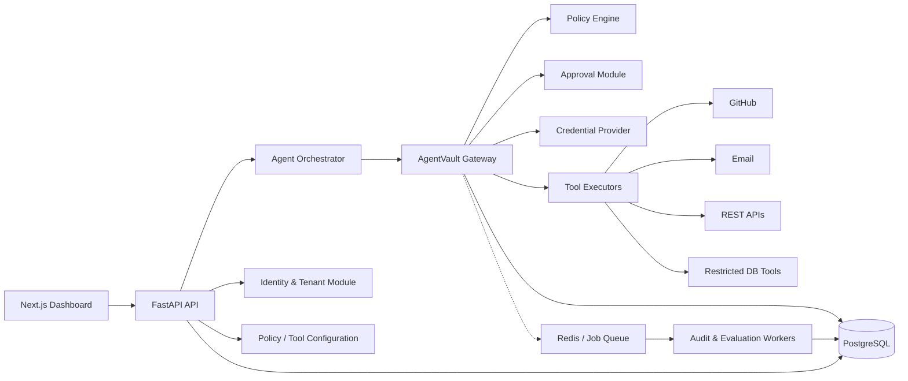
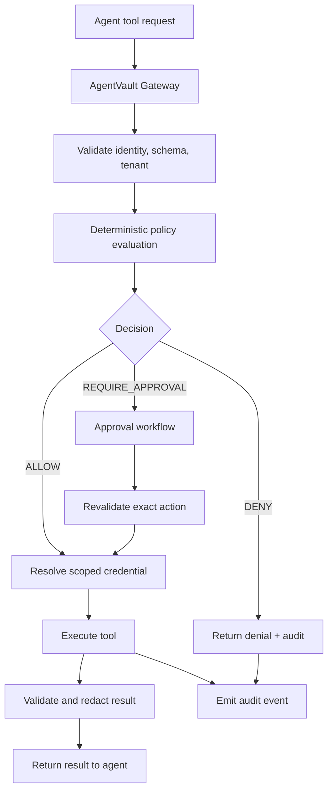
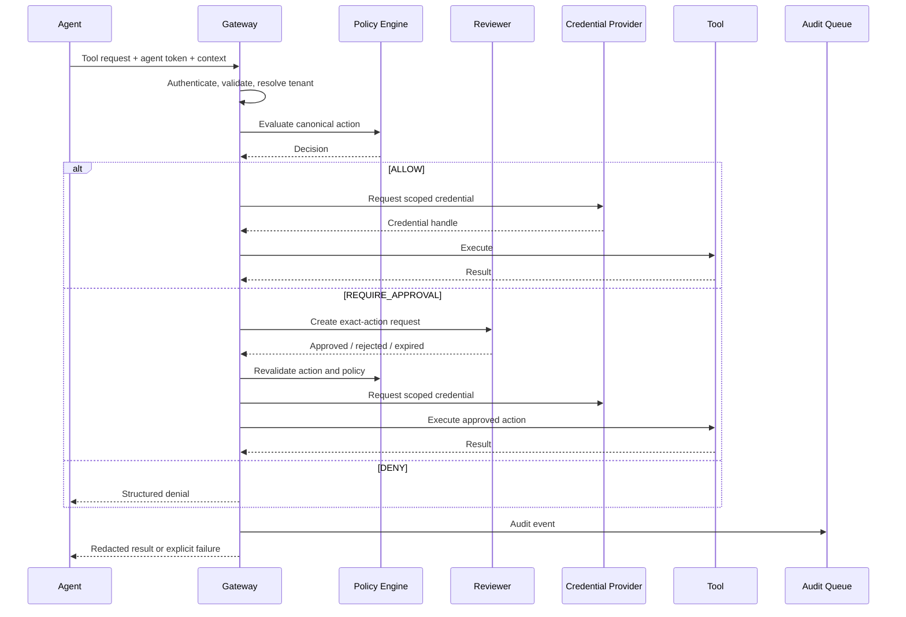
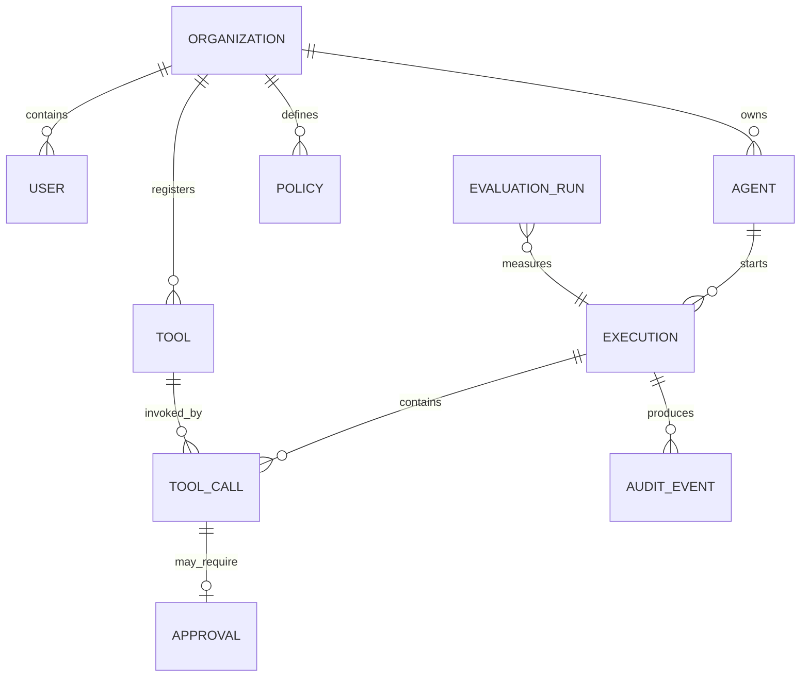
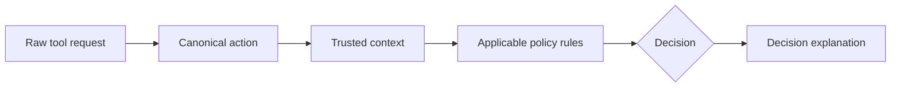
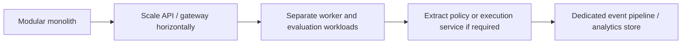
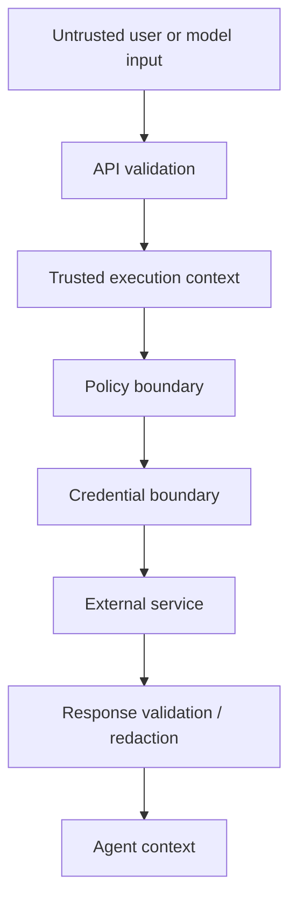
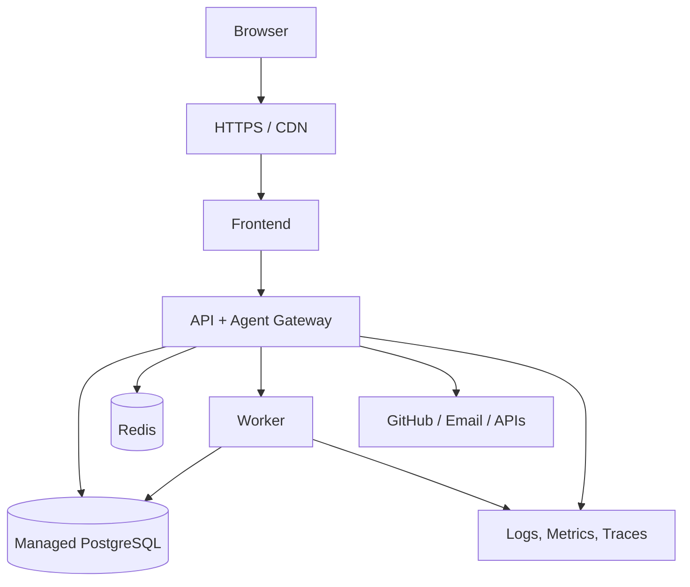

# AgentVault High-Level Design
 
**Related documents:** [PRD](./prd.md), [User Personas and Flows](./user_personas_and_flows.md)

## 1. Design Goals

- Enforce one security boundary for every protected tool call.
- Keep policy decisions deterministic and low latency.
- Keep the agent layer independent from security enforcement.
- Start as a modular monolith; scale individual modules later.
- Separate the user-facing execution path from analytics and audit processing.
- Preserve tenant isolation, traceability, and explicit failure states.

## 2. Architectural Approach

AgentVault will initially use a **modular monolith with clear internal boundaries**:

The modules share deployment initially, but communicate through typed interfaces so they can be extracted later if scale or isolation requires it.

## 3. Core Components

| Component | Responsibility |
|---|---|
| **Dashboard** | User, agent, policy, approval, execution, and evaluation UI |
| **API Layer** | Authentication boundary, request validation, tenant context, orchestration APIs |
| **Agent Orchestrator** | Planning, model interaction, tool selection, workflow state |
| **Agent Identity** | Agent registration, status, scoped credentials, ownership |
| **Tool Registry** | Tool metadata, schemas, operations, risk, resource scope |
| **AgentVault Gateway** | Mandatory enforcement boundary for protected calls |
| **Policy Engine** | Deterministic `ALLOW`, `DENY`, or `REQUIRE_APPROVAL` decision |
| **Approval Module** | Exact-action approval lifecycle and revalidation |
| **Credential Provider** | Scoped access to OAuth tokens/secrets without exposing them to the model |
| **Tool Executors** | GitHub, email, REST, and restricted database adapters |
| **Audit Module** | Append-oriented execution and security events |
| **Evaluation Module** | Scenario execution, metric calculation, comparison |
| **PostgreSQL** | Tenant data, configuration, state, audit metadata, evaluation results |
| **Redis/Worker** | Optional asynchronous audit, notifications, and evaluation jobs |

## 4. Protected Execution Boundary

**Invariant:** protected tools are not directly available to the agent. The gateway is the only execution path.

## 5. Request Lifecycle

## 6. Latency-Sensitive vs Asynchronous Work

### Synchronous path

Required before returning a tool result:

1. Agent authentication.
2. Tenant and resource resolution.
3. Schema validation.
4. Deterministic policy evaluation.
5. Approval decision, when already available.
6. External tool execution.
7. Result validation and redaction.

### Asynchronous path

Must not unnecessarily block the tool result:

- Audit event enrichment.
- Metrics aggregation.
- Evaluation summaries.
- Notifications.
- Security-event aggregation.

Critical authorization and execution audit events must be durably written before reporting a successful side effect.

## 7. Data Ownership and Tenant Isolation

Every organization-owned row must contain an organization identifier. Services must derive tenant context from authenticated identity, not from untrusted agent arguments. Cross-tenant queries must be rejected and tested.

## 8. Policy Evaluation Model

The canonical action should include:

- Organization, user, and agent.
- Tool and operation.
- Canonical resource.
- Normalized arguments.
- Risk classification.
- Correlation and execution IDs.

Policy evaluation must be deterministic, independently testable, explainable, and fail closed when required context is missing. AI risk analysis is advisory only.

## 9. Reliability and Failure Handling

| Failure | Required behavior |
|---|---|
| Invalid tool or arguments | Reject before external execution |
| Missing identity or tenant context | Fail closed |
| Policy engine unavailable | Do not execute protected action |
| Approval expired or changed | Require a new approval |
| External timeout | Return explicit timeout; bounded retry only if safe |
| External rate limit | Back off and surface retry state |
| Tool response contains sensitive data | Redact before returning/logging |
| Worker or audit delay | Preserve critical event; mark processing state |
| Agent retries side effect | Use idempotency key and detect duplicate |

No error may be converted into a success-shaped response.

## 10. Scalability Plan

### Initial scale

- Modular monolith.
- PostgreSQL with tenant and time-based indexes.
- Connection pooling.
- Stateless API and gateway instances.
- Redis only for short-lived state, queues, or distributed locks when needed.

### Growth path

Scale boundaries should be driven by measured bottlenecks, not by component count.

## 11. Security Boundaries

- User input, email content, tool results, and model output are untrusted.
- Credentials exist only inside the credential/executor boundary.
- Authorization is server-side.
- Approval is bound to an exact canonical action.
- Audit data is tenant-scoped and sensitive values are redacted.

## 12. Observability

Every request and tool call should carry:

- `organization_id`
- `user_id`
- `agent_id`
- `execution_id`
- `tool_call_id`
- `correlation_id`

Track:

- Policy decision latency.
- Gateway latency overhead.
- Approval wait time.
- External tool latency.
- Failure and timeout rate.
- Denied and suspicious calls.
- Duplicate side effects.
- Audit coverage.

Use structured logs, metrics, and traces. Never log raw credentials or unredacted sensitive payloads.

## 13. Deployment View

Local development uses Docker Compose. Production deployment should add managed database, secret manager, TLS, backups, migrations, monitoring, and controlled network egress.

## 14. Key Architecture Decisions

| Decision | Rationale |
|---|---|
| Modular monolith first | Faster delivery, simpler debugging, clear future extraction boundaries |
| Gateway-owned enforcement | Prevents agents from bypassing authorization |
| Deterministic policy first | Security decisions must be testable and predictable |
| AI risk advisory only | Model output must never grant authority |
| PostgreSQL as system of record | Strong consistency for identity, policy, approval, and audit metadata |
| Async analytics | Keeps dashboards and evaluation work off the critical execution path |
| Scoped credentials | Limits blast radius and prevents model credential exposure |
| Idempotency for side effects | Prevents duplicate email or issue operations |

## 15. HLD Acceptance Criteria

The design is ready for LLD when:

- Every protected tool call has one documented gateway path.
- Tenant context is established before policy evaluation.
- Policy, approval, credential, execution, and audit boundaries are explicit.
- Baseline and protected modes can share the agent workflow.
- Critical synchronous and asynchronous responsibilities are separated.
- Failure, retry, timeout, and duplicate-side-effect behavior is defined.
- Scaling boundaries and observability identifiers are defined.
- No component requires premature microservice deployment.

