# AgentVault: User Personas and Flows

**Related document:** [PRD](./prd.md)

## 1. Product Actors

| Persona | Primary responsibility | Main needs |
|---|---|---|
| **Developer** | Builds agents and registers tools | Clear contracts, easy integration, predictable failures |
| **Platform Admin** | Manages organization, agents, tools, and access | Tenant isolation, roles, credential control |
| **Security Engineer** | Defines policies and investigates risks | Deterministic enforcement, audit trail, security events |
| **Approval Reviewer** | Reviews sensitive actions | Exact action details, safe approve/reject experience |
| **Agent User** | Runs project-assistant tasks | Useful results, execution visibility, safe automation |
| **Evaluator** | Compares baseline and protected runs | Repeatable scenarios, trustworthy metrics |

> In the MVP, one person may perform multiple roles. Roles are separated here to keep responsibilities clear.

## 2. Role Relationship

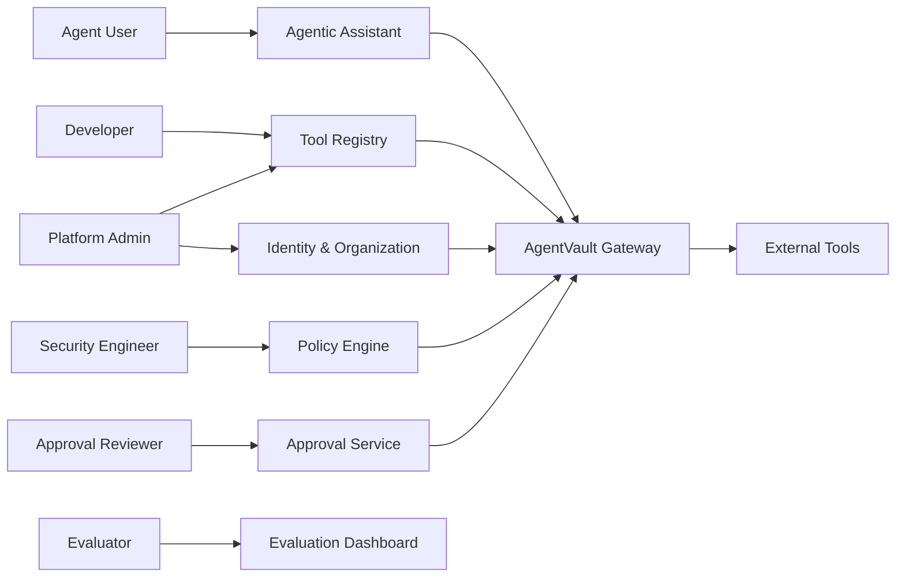

## 3. Core User Journey

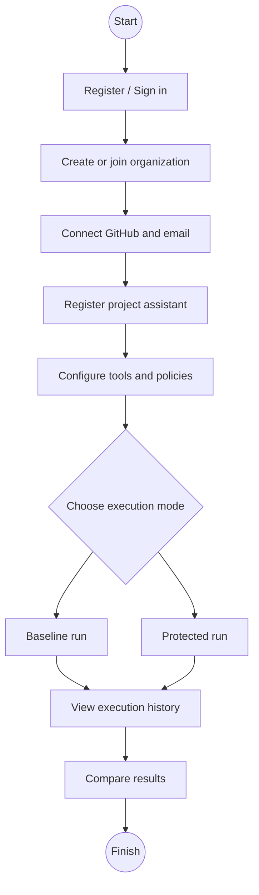

## 4. Onboarding Flow

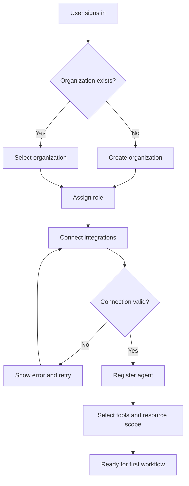

### Onboarding outcomes

- The user belongs to an organization.
- Integrations use minimum required scopes.
- The agent has a unique identity and limited permissions.
- No raw external credential is shown to the agent or stored in normal application data.

## 5. Agent Registration and Configuration

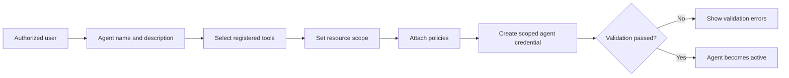

## 6. Primary Workflow: Project Status Update

### 6.1 Shared agent workflow

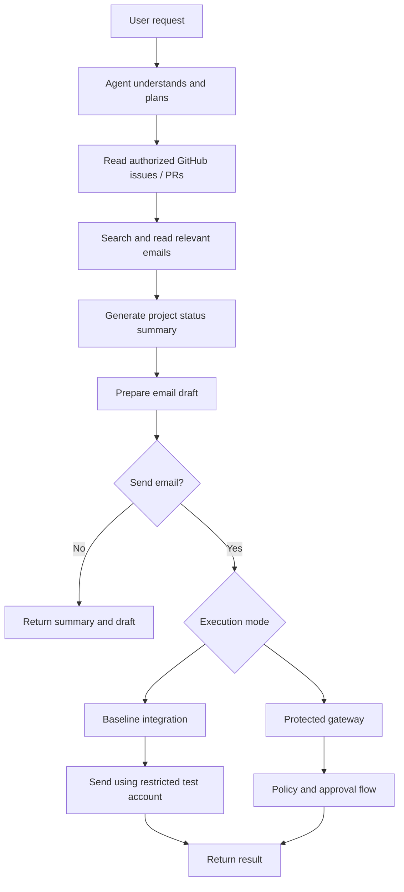

### 6.2 Baseline mode

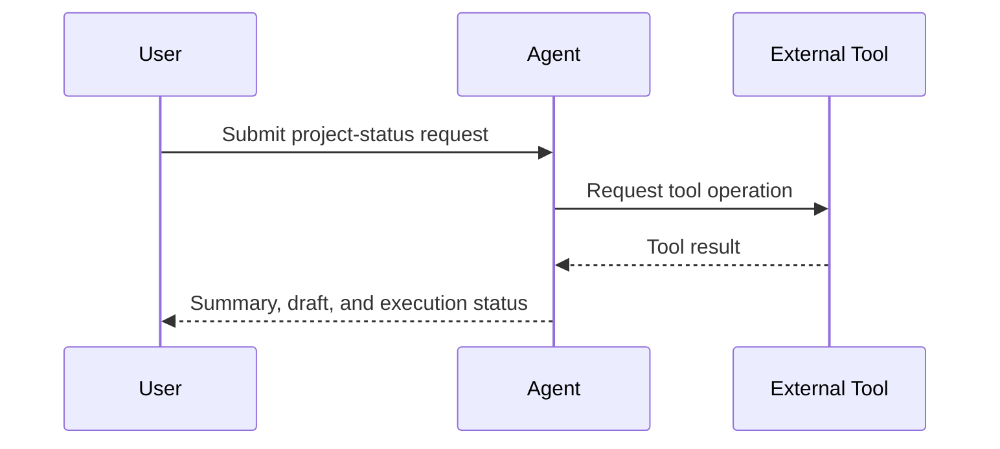

Baseline mode is used for comparison and must still use restricted accounts, safe scopes, and execution logging.

### 6.3 Protected mode

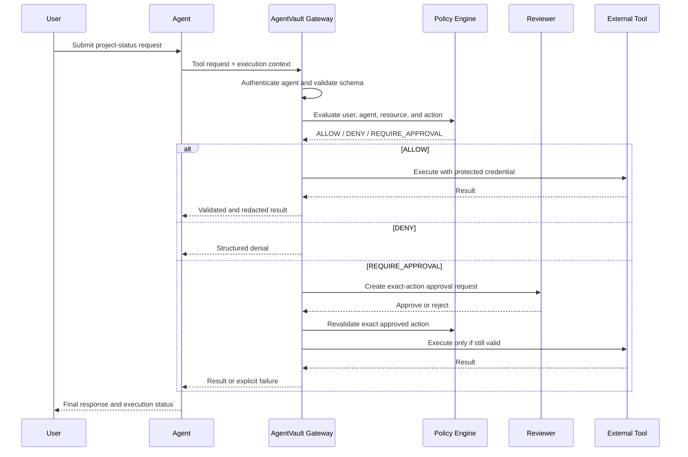

## 7. Approval Flow

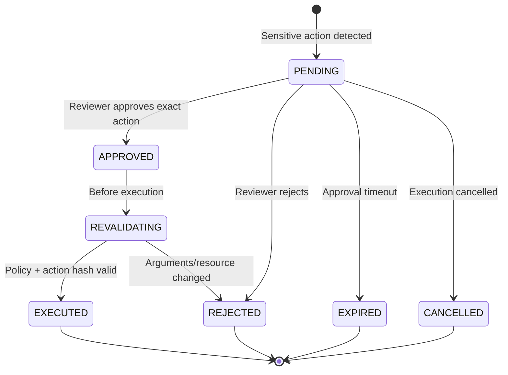

### Reviewer must see

- Requesting user and agent.
- Tool and operation.
- Resource and recipients.
- Exact email subject, body, and attachments where applicable.
- Policy decision and risk explanation.
- Expiration time.

Approval authorizes only the exact reviewed action. Any changed argument requires a new decision.

## 8. Policy Decision Flow

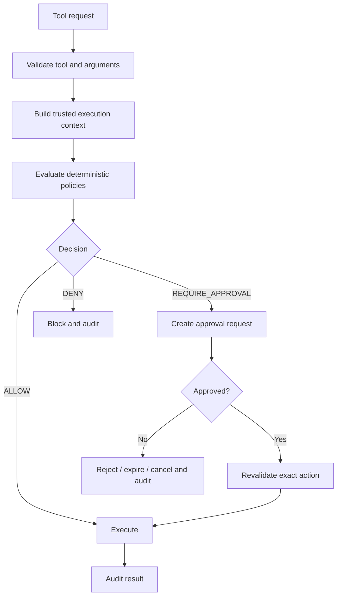

**Rule:** AI risk analysis can provide warnings, but it cannot grant permission or override a deterministic deny.

## 9. Audit and Monitoring Flow

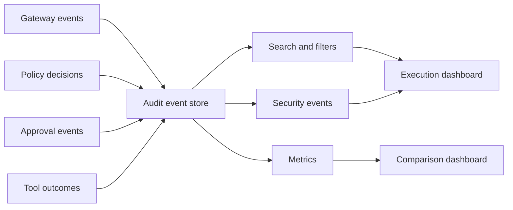

Every protected request should be traceable using an execution ID and correlation ID.

## 10. Evaluation Flow

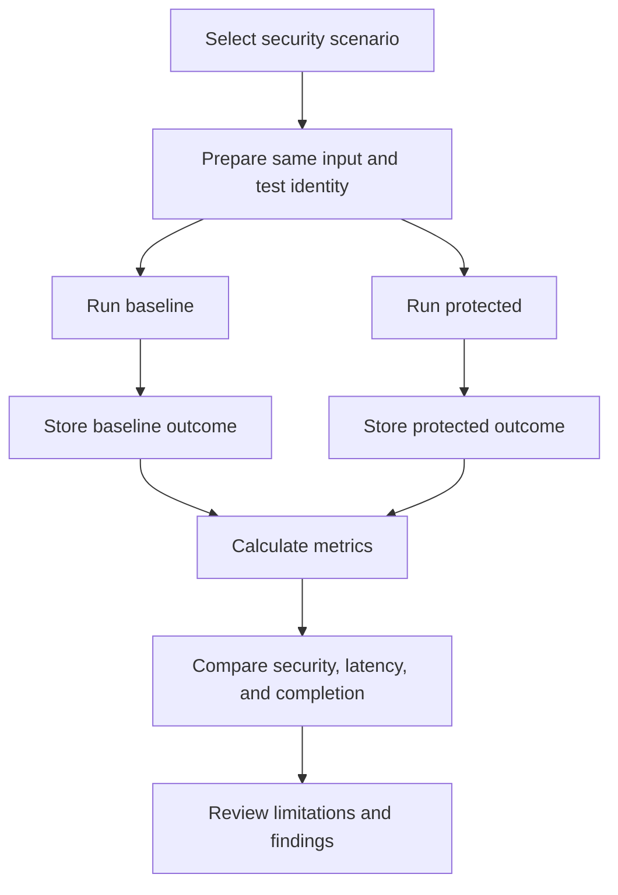

### Initial scenarios

- Unauthorized repository access.
- Unauthorized email sending.
- Prompt injection in email content.
- Cross-organization access.
- Modified arguments after approval.
- Duplicate side effect after retry.

## 11. Important UX Rules

1. Always show whether the run is **Baseline** or **Protected**.
2. Show tool-call progress without exposing secrets.
3. Show clear `allowed`, `denied`, `approval required`, `failed`, and `completed` states.
4. Never present a denied or failed action as successful.
5. Make approval details exact and reviewable.
6. Keep audit and evaluation data tenant-scoped.
7. Explain policy decisions in understandable language.

## 12. MVP Flow Coverage

| Flow | MVP status |
|---|---|
| Sign in and organization setup | Required |
| Connect GitHub and email | Required |
| Register agent and tools | Required |
| Configure basic policies | Required |
| Run baseline workflow | Required |
| Run protected workflow | Required |
| Approve or reject email send | Required |
| Search execution history | Required |
| Compare baseline and protected results | Required |
| Advanced anomaly detection | Post-MVP |
| Universal MCP interception | Post-MVP |

